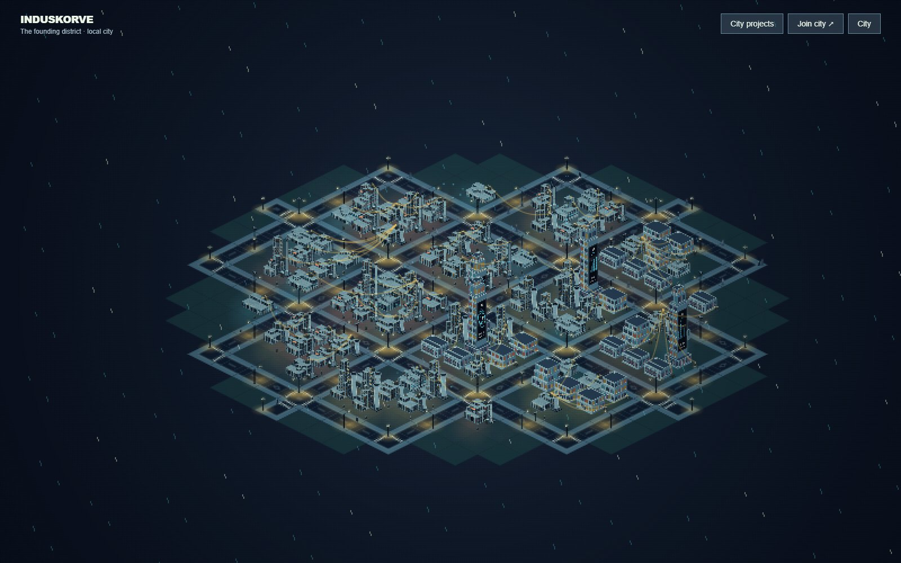
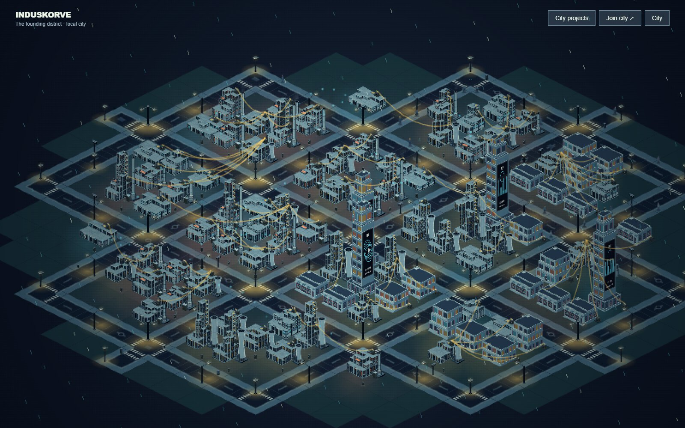
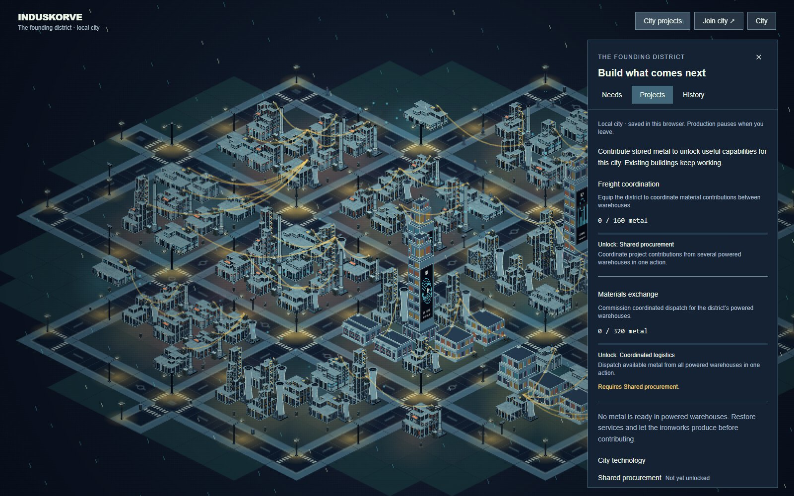

# Induskorve

**An industrial city, built one contribution at a time.**

Explore a rain-soaked isometric district of foundries, tangled power lines, glowing screens and small street lives. Restore a useful connection, expand production, fund the next city project—and leave something behind.



**Prototype: [Pages activation pending](https://github.com/hgosansn/Induskorve/settings/pages)** · [How it works](docs/gameplay-foundation.md) · [Run locally](#run-locally)

## A city worth looking into

- **One continuous city.** Pan and zoom from the skyline to a factory apron. Construction reveals nearby ground and grows an irregular city outline.
- **Useful contributions.** Inspect shortages, forecast changes, place buildings and retrofit machinery. Power, storage, production and heat recovery follow explicit local rules.
- **Projects with a purpose.** Contribute stored metal to unlock pooled funding and coordinated dispatch. Accepted actions retain contribution attribution.
- **A mixed skyline.** Modular industrial halls, apartments, residential skyscrapers and small shops share the streets. Animated adverts occupy real building facades.
- **Small street lives.** Faceless pedestrians stroll, pause and cross at designated crossings. Click to inspect a character; drag your own pedestrian to a nearby path.
- **Industrial nocturne.** Pixel rendering, rain, amber lights, cyan displays and warm furnace accents. Switch Pixel style and Rain independently under **City**; reduced motion freezes ambient animation.



## Try the contribution loop

Start as a spectator. Open **City projects** to explore the district's needs, projects and history. **Join city** unlocks contribution controls and gives you a local character. Preview the effect of a change before confirming it, then inspect the result.



| Action                        | Control                                       |
| ----------------------------- | --------------------------------------------- |
| Move around                   | Drag the city background                      |
| Zoom                          | Mouse wheel or City controls                  |
| Inspect a building            | Click its ground square                       |
| Inspect a pedestrian          | Click near the character                      |
| Move your pedestrian          | Drag and drop near a sidewalk or entrance     |
| Build                         | Join → Contribute → preview → choose location |
| Cancel placement or selection | Escape; right-click also cancels placement    |
| Explore the artwork           | City → Design atlas                           |

## Prototype status

The source and screenshots are published to `main`. The Pages build passes, but GitHub refused automatic site creation with “Resource not accessible by integration.” A repository owner must select **Settings → Pages → Source → GitHub Actions**, then re-run the [Pages workflow](https://github.com/hgosansn/Induskorve/actions/workflows/pages.yml). The intended demo address is <https://hgosansn.github.io/Induskorve/>; it is not live until that deployment succeeds.

**The public prototype runs in browser-local mode.** Your city, identity and contributions are saved in that browser. Local production runs while joined and visible and pauses when you leave. Construction and feedstock are currently free. Ambient pedestrians are scenery, not online players. Residents, rent and shop commerce are not simulated.

The long-term direction is one persistent city shared by strangers. SpacetimeDB reducers, synchronized state, creator permissions and SpacetimeAuth integration are implemented and tested against an isolated real server. Hosted multiplayer and external sign-in still require project configuration and acceptance. See [live integration](docs/spacetimedb.md); the local demo does not imply an active multiplayer service.

All screenshots above come from the running prototype. Reference art and experimental mesh studies are authoring materials, excluded from release output.

## Run locally

Use **Node.js 24** and npm:

```sh
npm ci
npm run dev
```

Open the localhost URL printed by Vite. Check and build with:

```sh
npm run check
npm run build
npm run preview
```

For browser tests:

```sh
npx playwright install chromium
npm run test:e2e
```

`npm run test:live` additionally requires SpacetimeDB CLI/server 2.13.0 and creates isolated test databases. See [setup](docs/spacetimedb.md).

## Inside the project

React 19, strict TypeScript, Vite, Tailwind 4, shadcn/ui, Zustand and Zod support the Canvas 2D renderer. Buildings share deterministic assemblies, declared service ports and mounting/clearance checks. Static artwork is cached; animated systems share visibility and reduced-motion controls.

| Area                                | Location                                           |
| ----------------------------------- | -------------------------------------------------- |
| Rules and shared content            | `src/domain/city/`, `shared/city/`                 |
| Commands and state                  | `src/application/`                                 |
| Contribution and inspection UI      | `src/features/city/`                               |
| Building kit and rendering          | `src/rendering/assembly/`, `src/rendering/canvas/` |
| Live gateway and generated bindings | `src/infrastructure/spacetimedb/`                  |
| Authoritative live module           | `spacetimedb/src/`                                 |

Read more: [architecture](docs/architecture.md), [persistent actions](docs/persistent-actions.md), [building assemblies](docs/building-assemblies.md), [streets](docs/streets.md), [rendering performance](docs/render-performance.md), [art iteration](docs/asset-iteration.md).

## Saves and deployment

Existing `onecity-v2` saves migrate to `induskorve:city:v3` on the next saved action. Invalid saves are preserved. A different hostname has separate storage; your localhost city does not automatically transfer to the hosted prototype.

GitHub Actions checks and builds the app, then publishes `dist/` to GitHub Pages on pushes to `main`. Release output excludes playtest and asset-review pages. `/playtest.html` remains a development-only experiment with its own save namespace. See [deployment](docs/deployment.md).
